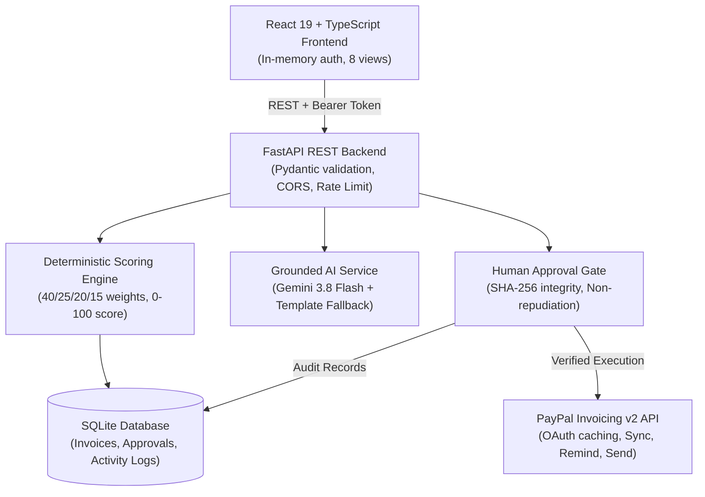

# PayTriage

> **"Know which unpaid invoices need you first, and why."**

PayTriage is an explainable payment recovery intelligence platform for merchants. It prioritizes overdue invoices using a transparent, multi-factor scoring model, provides grounded AI diagnostic summaries, generates customizable reminder communications, and integrates directly with PayPal Invoicing APIs behind a strict human approval gate.

---

## 1. Problem & Solution

### The Problem
Merchants with high invoice volumes struggle to decide which unpaid accounts to follow up on each day. Existing collections systems rely either on arbitrary rules (e.g. oldest first) or opaque "black-box" machine learning predictions that fail to justify why an invoice is flagged. Autonomous outreach bots can inadvertently damage sensitive client relationships.

### The Solution
PayTriage delivers:
- **Deterministic Priority Scoring:** Invoices are scored from 0 to 100 based on verified facts (aging, balance, prior reminders, client payment history). Every point is explainable.
- **Grounded AI Diagnostics:** Combines large language models with template fallbacks to generate plain-language explanations of recovery risk.
- **Human-in-the-Loop Approval Gate:** Autonomous agents can propose reminders, but only an authenticated human merchant can approve and dispatch actions.
- **PayPal Invoicing v2 Integration:** Live sandbox synchronization, OAuth token management, invoice creation, reminder transmission, and post-action verification.

---

## 2. Architecture



---

## 3. Technology Stack

- **Backend:** Python 3.12, FastAPI, Pydantic v2, SQLite, Uvicorn, HTTPX, Python-dotenv.
- **AI Engine:** Google GenAI SDK (`gemini-3.8-flash`) with structured output schemas and deterministic template fallback.
- **Payments:** PayPal Invoicing API v2 (Sandbox environment) with OAuth 2.0 client credentials.
- **Frontend:** React 19, TypeScript, Vite, Lucide Icons, Pure CSS design system.
- **Testing:** Pytest (156 tests), Vitest (4 tests), Playwright automated browser walkthrough.

---

## 4. Scoring Methodology

The PayTriage Recovery Score ($0$ to $100$) is a **decision-support priority score**, not a statistically predictive payment probability. It quantifies operational urgency across four components:

| Component | Weight | Max Points | Evaluation Rules |
| :--- | :---: | :---: | :--- |
| **Days Overdue** | 40% | 40 pts | 1-7 days: 10 pts; 8-14 days: 20 pts; 15-30 days: 30 pts; >30 days: 40 pts. |
| **Outstanding Amount** | 25% | 25 pts | <$500: 5 pts; $500-$1,999.99: 12 pts; $2,000-$4,999.99: 18 pts; ≥$5,000: 25 pts (USD only). |
| **Reminder History** | 20% | 20 pts | 0 reminders: 0 pts; 1 reminder: 6 pts; 2 reminders: 12 pts; ≥3 reminders: 20 pts. |
| **History & Risk Signals** | 15% | 15 pts | On-time history: 0 pts; Mixed history: 5 pts; Late history: 10 pts; Broken promise: +15 pts; Missing history assumption: 4 pts. |

### Priority Thresholds
- **Critical:** Score 75 – 100
- **High:** Score 50 – 74
- **Medium:** Score 25 – 49
- **Low:** Score 0 – 24

Excluded statuses (`PAID`, `CANCELLED`, `DRAFT`, `DISPUTED`, not-yet-due) receive `score=None` and are assigned operational actions (`wait`, `send_invoice`, `manual_review`).

---

## 5. Security & Human Approval Model

- **Authentication:** In-memory bearer token issued via PBKDF2-HMAC password verification. Never stored in `localStorage`.
- **Role Isolation:** AI agents and automated jobs may propose actions (`role="ai"`), but only human merchants (`role="merchant"`) can approve or execute.
- **Cryptographic Tamper Protection:** Every action proposal computes a canonical SHA-256 digest over target invoice, action type, and parameters. If an operator alters the text or parameters post-approval, execution is rejected with `HTTP 409 Conflict`.
- **Rate Limiting:** Sliding-window in-memory rate limiting applied to login, AI endpoints, assistant queries, and action executions.
- **Audit Logging:** Every state transition and verified payment check is logged immutably. The label `Verified & Sent` is applied exclusively to verified transmissions.

---

## 6. PayPal Invoicing v2 Live Verification

The system communicates directly with PayPal Sandbox (`https://api-m.sandbox.paypal.com`):
1. **OAuth 2.0:** Secure client credentials grant with proactive caching and expiry refresh.
2. **Draft & Send:** Invoices in `DRAFT` status can be sent to recipients via `/v2/invoicing/invoices/{id}/send`.
3. **Payment Reminders:** Invoices in `SENT` or overdue status receive official reminder transmissions via `/v2/invoicing/invoices/{id}/remind`.
4. **Verification:** Live polling confirms updated invoice status (`SENT`, `PAID`, `UNPAID`) before logging execution as `verified`.

---

## 7. Environment Variables

Create a `backend/.env` file based on `.env.example`. The system requires the following six variables:

```ini
GEMINI_API_KEY=your_gemini_api_key_here
PAYPAL_CLIENT_ID=your_paypal_sandbox_client_id_here
PAYPAL_CLIENT_SECRET=your_paypal_sandbox_client_secret_here
DEMO_USER=your_demo_username_here
DEMO_PASSWORD=your_demo_password_here
SESSION_SECRET=your_secure_session_secret_min_32_chars
```

*Note: In `.env.example`, all values are placeholders. The live test suite isolates all keys.*

---

## 8. Installation & Setup

### Prerequisites
- Python 3.12+
- Node.js 18+ and npm

### Backend Setup
```bash
cd backend
python -m venv .venv
# Windows
.venv\Scripts\activate
# Linux/macOS
source .venv/bin/activate

pip install -r requirements.txt
python seed.py
uvicorn backend.main:app --host 127.0.0.1 --port 8000
```

### Frontend Setup
```bash
cd frontend
npm install
npm run build
npm run dev
```
Open [http://localhost:5173](http://localhost:5173) in your browser.

---

## 9. Testing & Verification

### Backend Tests
```bash
# Run 156 fast unit and mock integration tests
python -m pytest -q

# Opt-in live PayPal Sandbox roundtrip check
RUN_LIVE_PAYPAL=1 python -m pytest -q -m live_paypal

# Opt-in live Gemini AI check
RUN_LIVE_AI=1 python -m pytest -q -m live_ai
```

### Frontend Tests
```bash
cd frontend
npm run lint
npm run test -- --run --no-cache
```

### Automated Browser Walkthrough
```bash
cd frontend
node scripts/demo_walkthrough.js
```
Captures step-by-step screenshots to `docs/screenshots/` (Login, Command Center, Recovery Center, Invoice Detail, Approval Dialog, Activity Log).

---

## 10. Known Limitations

1. **AI Live Quota & Timeout Fallback:** On free-tier Gemini API quotas, high demand may trigger rate limits (`429 RESOURCE_EXHAUSTED`) or timeouts. PayTriage handles this by falling back to deterministic template generation with `fallback_reason="timeout"` or `"quota"`.
2. **Currency Scope:** Quantitative balance scoring rules are calibrated for USD invoices. Non-USD invoices receive 0 amount points and include an unavailable-information notice.
3. **Demo Data Boundary:** Benchmark demo invoices (`is_demo=True`) are restricted to `record_copied_reminder`. Only live Sandbox invoices (`is_demo=False`) can dispatch real PayPal API calls.
