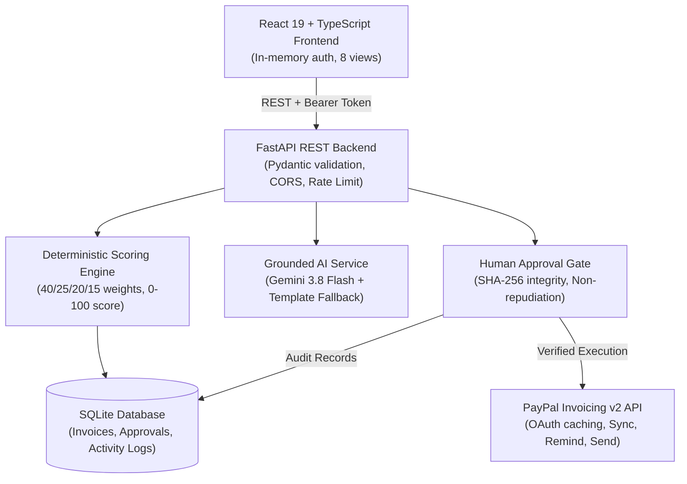

# PayTriage Architecture

PayTriage is an intelligent, explainable payment recovery decision-support system for merchants managing overdue accounts with PayPal Invoicing integration.

## System Components

1. **Frontend (`frontend/`)**: React 19, TypeScript, Vite. Operates with in-memory session tokens (strictly avoiding `localStorage`). Priority indicators use semantic colors (Critical red, High orange, Medium amber, Low green).
2. **Backend API (`backend/`)**: FastAPI with async lifespan, Pydantic v2 schemas for all payloads, and strict CORS.
3. **Scoring Engine (`backend/recovery/`)**: Pure deterministic function evaluating Days Overdue (up to 40), Amount (up to 25), Reminder History (up to 20), and Risk/History Signals (up to 15). Priority bands: Critical (75-100), High (50-74), Medium (25-49), Low (0-24).
4. **AI Grounded Explainer & Assistant (`backend/ai/`)**: Integrates `gemini-3.8-flash` with strict JSON schemas, XML boundary delimiters against prompt injection, and deterministic rule-based template fallback upon timeout or quota limits.
5. **PayPal Invoicing v2 Service (`backend/paypal/`)**: OAuth client credentials token manager with thread-safe caching and expiry buffer. Supports invoice synchronization, status mapping, live transmission, and verification.
6. **Human Approval Gate (`backend/actions/`)**: Pre-action proposal generating SHA-256 payload digest. Enforces merchant human approval (AI agents cannot approve or execute) and rejects modified parameters with HTTP 409 Conflict.
